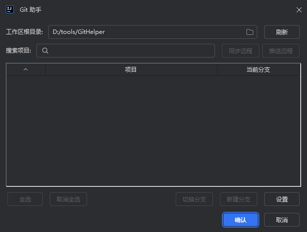
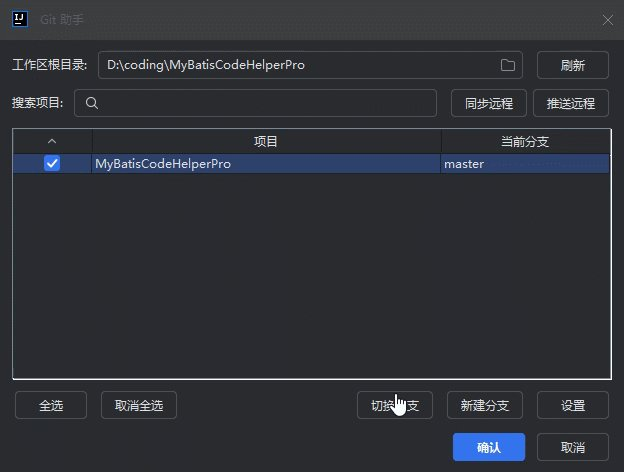
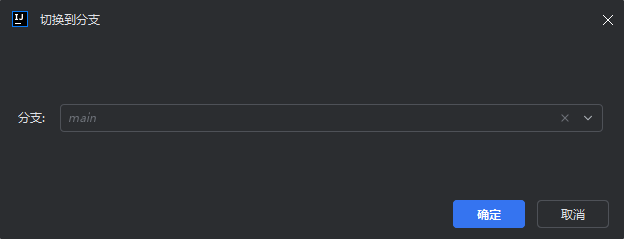
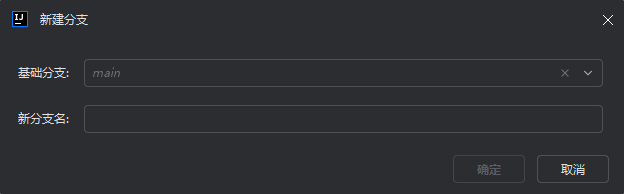
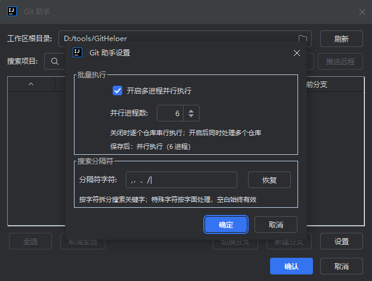

# Git Helper

[](https://plugins.jetbrains.com/plugin/36243-git-helper)

IntelliJ IDEA 插件：批量选择工作区下的多个 Git 仓库，一次性切换分支或基于源分支新建分支，本地未提交的改动会被保留。

An IntelliJ IDEA plugin that batch-switches (or creates) branches across every Git repository under one workspace root, while preserving local uncommitted changes.

---

## 功能特性 / Features

| 功能 | 说明 |
| --- | --- |
| 批量切换分支 | 以远程代码为准强制同步后，再把本地改动文件覆盖回去 |
| 批量新建分支 | 先同步源分支远程代码，再基于源分支新建目标分支 |
| 批量同步远程 | `fetch --prune` + `rebase`，一键拉平所有仓库 |
| 批量推送 | 一次推送到所有选中仓库的远端 |
| 本地改动保护 | 切换前自动备份被跟踪的改动（`~/.git-helper-backup/<timestamp>`），切换后自动还原 |
| 多进程并行 | 可选 1 - 32 个并发进程，带进度展示与分仓库日志 |
| 搜索项目 | 按关键字快速过滤仓库列表，分隔字符可自定义 |
| 多种入口 | Tools 菜单、主工具栏、导航栏、左侧「Git 助手」工具窗口 |

- Safer Git invocations: 45s timeout, non-interactive credentials, UTF-8 output so non-ASCII branch names work.
- Tracked modifications are backed up before switching and restored afterwards, so uncommitted work is not lost.

## 界面截图 / Screenshots

主界面：选择工作区根目录后自动发现其中的 Git 仓库。



勾选多个仓库，底部按钮批量操作（切换分支 / 新建分支 / 设置）。



切换到指定分支：



基于源分支新建分支：



批量执行设置（并行进程数、搜索分隔字符）：



## 演示视频 / Demo

[assets/screenshots/git-helper-demo.mp4](assets/screenshots/git-helper-demo.mp4)

## 安装 / Installation

**从 Marketplace 安装（推荐）**

`Settings` → `Plugins` → `Marketplace` → 搜索 `Git Helper` → `Install` → 重启 IDE。

**从源码构建**

```bash
git clone https://github.com/ChildeShu/GitHelper.git
cd GitHelper
./gradlew buildPlugin
# 产物：build/distributions/git-helper-<version>.zip
```

然后 `Settings` → `Plugins` → 齿轮 → `Install Plugin from Disk...` 选择该 zip。

**开发调试**

```bash
./gradlew runIde
```

## 环境要求 / Requirements

- IntelliJ IDEA 2024.1 - 2024.3（build 241 - 243.*），其它 IntelliJ Platform IDE 同样适用
- 系统 `PATH` 中可用的 Git 命令行

## 使用说明 / Getting Started

1. 打开 `Tools` 菜单 → `Git 助手`，或点击主工具栏 / 导航栏的图标，或使用左侧 `Git 助手` 工具窗口。
2. 选择「工作区根目录」，插件会扫描其下所有含 `.git` 的仓库，点「刷新」可重新扫描。
3. 在列表中勾选需要操作的仓库（可用「搜索项目」过滤，支持按自定义分隔字符拆分关键字）。
4. 点击「切换分支」或「新建分支」，输入分支名后确认。
5. 需要拉取/推送时使用「同步远程」「推送远程」。

## 安全说明 / Safety Notes

- 执行切换前会把仓库的远程状态强制同步（`fetch --prune` + 重置到目标分支），本地已跟踪的改动会在切换后还原。
- 每次批量操作都会在 `~/.git-helper-backup/<timestamp>/` 下留一份备份，可用于人工回滚。
- Git 命令带 45 秒超时、禁用交互式凭据弹窗，避免批量执行时卡死。

## 反馈 / Feedback

- 问题与建议：[GitHub Issues](https://github.com/ChildeShu/GitHelper/issues)
- 邮箱：jiansite@qq.com
- Marketplace：[Git Helper](https://plugins.jetbrains.com/plugin/36243-git-helper)

## 支持作者 / Reward


## 许可证 / License

MIT License, Copyright © 2026 Childe Shu
